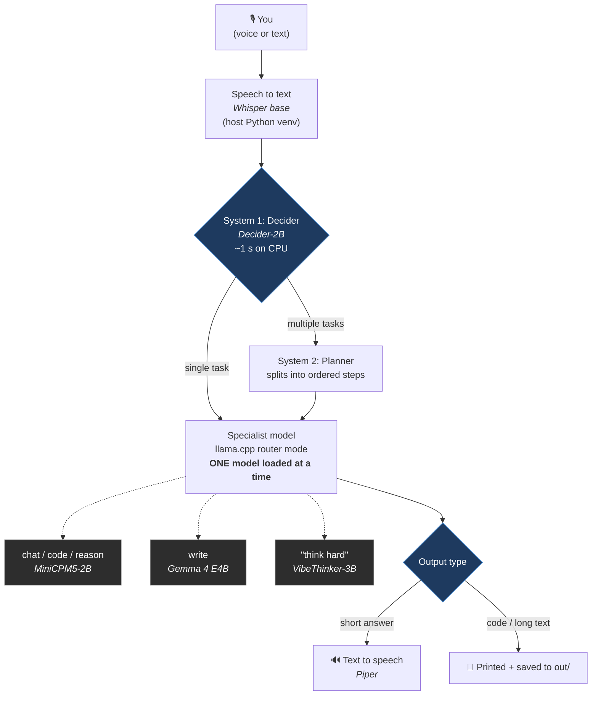

# Tinker

A local, voice-first assistant built from **tiny specialist models** that run on an ordinary laptop. No cloud, no GPU required.

A small decision model reads each request and picks the right specialist (chat, code, reasoning, writing). Only one specialist is in memory at a time, so a 16 GB laptop is enough. Everything heavy runs in rootless Podman, so your host stays clean.

> **Status: alpha.** It works end to end on one machine (below). It has not been tested on other hardware, other Linux distributions, or other speakers' voices. Small models make mistakes: read [Known limitations](#known-limitations) before trusting an answer.

## How it works



Podman pods: `tinker-brain` (llama.cpp + decider) and `tinker-observe` (Dozzle log viewer). Both start with `tinker on` and stop when you quit.

## Requirements

- Linux with **rootless Podman** (tested: Fedora 44, Podman 5.8.7), `curl`, `jq`, `python3` with `venv`
- For voice: PipeWire's `pw-record` and `pw-play` (Fedora: package `pipewire-utils`)
- About **20 GB free disk** (models about 8 GB, container images about 4 GB; the installer checks)
- 16 GB RAM or more recommended (tested on 32 GiB; one specialist is loaded at a time, about 1.5 to 5 GB, plus about 1.1 GB for the decider)

## Install

```bash
git clone https://github.com/Youbey/tinker.git && cd tinker
./install.sh --dry-run     # prints every action, changes nothing
./install.sh               # installs everything and ends with a self-test
```

`install.sh` never uses `sudo`. It checks prerequisites and prints what is missing, auto-detects the profile (CPU or Vulkan) and verifies Vulkan from inside the container, downloads the models into `models/`, builds the decider image, writes `config/models.ini` and `config/tinker.env`, links `tinker` into `~/.local/bin`, and finally starts the stack, asks one question and prints `PASS` or `FAILED`. It is safe to re-run: finished steps are skipped (a fully cached re-run took about one minute here; a first install is dominated by the downloads and the decider image build, which compiles `llama-cpp-python`).

| Option | Effect |
|---|---|
| `--dry-run` | print every action, change nothing |
| `--cpu` / `--vulkan` | force the llama.cpp profile (default: auto-detect) |
| `--no-voice` | text-only install: skips the speech packages and models |
| `--with-deep` | also download VibeThinker-3B (1.8 GB) for "think hard" requests |
| `--alias` | add `alias Tinker='tinker'` to your shell rc file (otherwise it only prints the line) |
| `--skip-selftest` | do not start the stack and ask a question at the end |
| `--uninstall` | remove pods, the decider image and the command link (keeps this folder and your models) |
| `--purge-images` | with `--uninstall`: also remove the llama.cpp and Dozzle images |

The llama.cpp and Dozzle images use floating tags, so a re-install can pull newer builds. The self-test is there to catch a build that no longer works.

## Use

| Command | What it does |
|---|---|
| `tinker on` | voice mode: starts the stack, push-to-talk (Enter, speak, Enter), stops the stack when you quit |
| `tinker speak` | you type, Tinker answers aloud |
| `tinker chat` | you type, Tinker answers in text (silent) |
| `tinker up` / `tinker off` | start / stop the stack without the assistant |
| `tinker build` | recreate the pods from the current config (downloads nothing) |
| `tinker status` | pods, memory use, which model is loaded |
| `tinker logs [container]` | follow a container's log (default `tinker-llm`) |

Say or type "goodbye" to quit. `TINKER_KEEP=1 tinker on` keeps the stack running after you quit. While the stack is up, Dozzle shows live logs and per-container CPU and RAM at `http://127.0.0.1:9999`.

Try: "what is the capital of Australia", "what is seventeen times twenty three", "write an email to my landlord about the heater" (printed and saved to `out/`), "write a bash script that backs up my documents and then explain each line" (planned into steps), "think hard about ..." (slow: VibeThinker, up to about three minutes).

## Configure

Everything model-specific is in `config/skills.json`; no code changes are needed to swap a model, change a prompt or add a skill. `config/models.ini` (generated by the installer, see `config/models.example.ini`) maps model names to GGUF files for llama.cpp's router; `config/tinker.env` holds the profile and thread counts. After editing `models.ini` or `tinker.env`, run `tinker build`. `skills.json` is read each time Tinker starts.

Fields of each entry under `skills`:

| Field | Meaning |
|---|---|
| `model` | model name from `config/models.ini` |
| `temperature`, `top_p`, `max_tokens` | sampling and length limit |
| `thinking` | `false` sends `enable_thinking: false` (MiniCPM5 and Qwen-style templates reason by default, which made short answers about five times slower and sometimes empty) |
| `output` | `speak` (read aloud), `answer_line` (read only the final `Answer:` line) or `file` (printed and saved to `out/`; Tinker says it is done) |
| `system` | the system prompt |
| `route_description` | how the decider recognises this skill. Skills without one are not routable (only `deep`, reached with "think hard") |
| `announce` | optional sentence spoken before slow work |
| `extra` | optional extra sampler options sent with each request, e.g. `top_k`, `min_p` |

Adding a skill is one entry. The decider will start choosing it, and the config is validated on startup:

<!-- skill-example -->
```json
"translate": {
  "route_description": "translate a sentence or text into another language",
  "model": "gemma4",
  "temperature": 0.3,
  "top_p": 0.95,
  "max_tokens": 400,
  "thinking": false,
  "output": "speak",
  "system": "You are a translator. Reply with the translation only."
}
```

Experiment without editing files: `TINKER_MODEL_CODE=gemma4 tinker chat` overrides the model of one skill (any skill name works).

## Measurement

Current measurements were done on: Dell Latitude 5430, Core i5-1245U (2 P-cores + 8 E-cores, 12 threads), Intel Iris Xe iGPU, 32 GiB RAM, Fedora Sway 44, Podman 5.8.7, Vulkan profile. One person, one session per number, so read them as rough orders of magnitude.

| What | Result |
|---|---|
| Decider routing (12 test cases, `bench/routing_bench.py`) | 9/9 skills, 12/12 multi-step flags; about 1.1 s per request on 8 threads (2.1 s on 4) |
| Chat, typed, models warm | about 2 to 4 s end to end |
| Arithmetic / short reasoning (no-think) | about 2 to 4 s |
| Single-step code request | about 2.5 to 5 s |
| Write an email (loads Gemma, about 130 words at about 9 tok/s) | about 15 to 27 s |
| Two-step plan (haiku, then French) | about 10 to 22 s |
| "Think hard" (VibeThinker-3B) | about 25 s to 3 minutes |
| Code benchmark, MiniCPM5-2B (5 tasks x 2 samples) | 7 to 9 of 10 depending on sampler settings; the hardest task fails most often |
| Speech recognition (Whisper base, 82 words, non-native English speaker) | 7% to 13% word error rate per session |
| Vulkan vs CPU | long-prompt reading 243 vs 78 tok/s; generation about 17 to 22 tok/s on both |
| Install with everything cached | about one minute |

Disk after install: about 13 GB (models 7 to 9 GB, images about 4 GB, venv 0.5 GB). Which models were tried, which were rejected and why is in [docs/MODELS.md](docs/MODELS.md).

## Benchmarks you can run

All benchmarks read the same config as Tinker, so you can test your own models and hardware. Test data lives in JSON files so cases can be added without touching code. Start the stack first (`tinker up`), then run from `bench/`:

| Script | Question it answers |
|---|---|
| `bench/routing_bench.py` | does the decider pick the right skill? (cases in `bench/routing_cases.json`) |
| `bench/chat_test.py` | one prompt to one model: reply and tokens per second |
| `bench/code_bench.py` | does a model's code pass the asserts in `bench/code_tasks.json`? Code runs in a throwaway Podman container with **no network** |
| `bench/reason_bench.py` | reasoning questions with answer patterns (`bench/reason_tasks.json`) |
| `bench/stt_bench.py` | speech engines' word error rate on **your** voice and sentences |
| `bench/mic_check.py` | input level of each microphone, to spot clipping |

## Known limitations

- **Small models are wrong in ways that sound confident.** Facts are unreliable (one run named the wrong city as Australia's capital). A 2B coder invented a nonexistent "package" while explaining a command and wrote scripts with placeholder paths. Read code before running it.
- **Speech recognition drops and swaps words**, especially names and technical terms ("heater" became "hater", "Tinker" became "Villa"; a whole sentence came back empty once with Parakeet). The vocabulary hint in `orchestrator/voice.py` helps with the project's own words. Tinker cannot run commands yet, so a misheard word cannot do damage, but a read-back confirmation is required before any action is added.
- **Push-to-talk only.** There is no wake word and no silence detection yet.
- **Latency of writing and deep thinking is high** on CPU-class hardware (above).
- **Tested only on Fedora 44** with one hardware configuration, one voice, English.
- **No tool use, no memory, no document search** yet. The avatar is a text face in the terminal.

## Privacy and security

- Everything runs locally; nothing is sent anywhere except model and package downloads at install time.
- All published ports are bound to `127.0.0.1`. llama.cpp's router mode warns against exposing it to untrusted networks: do not publish it on other interfaces.
- **Dozzle mounts Podman's API socket**, which gives that container control over your user's containers, and its SELinux label is disabled (needed for the socket mount). Skip or remove the `tinker-observe` pod if you do not want that.
- Your requests are logged to `logs/trace.jsonl` (set `"trace": false` in `config/skills.json` to stop) and the last 30 voice recordings are kept in `state/clips/`. Both are git-ignored. Delete them whenever you like.
- Code benchmarks run model-generated code only inside a container with no network. The `--runner local` option executes it on your machine and exists for tests: do not use it with untrusted models.

## Troubleshooting

- `tinker up` rebuilds the pods by itself if starting fails. If a model is "missing", re-run `./install.sh`.
- "Tinker's brain is not reachable": run `tinker up`. If the message says the server answered with an error, a model named in `skills.json` is missing from `models.ini`.
- Logs: `tinker logs tinker-llm`, `tinker logs tinker-decider`, or the Dozzle page.
- The mic is clipping (the loop says so): `TINKER_MIC_VOLUME=0.35 tinker on` (default 0.45, restored on exit). An earphone microphone gave much lower levels than the laptop's own microphone here.
- Speech engine and language: `TINKER_STT=parakeet` (needs `onnx-asr`), `TINKER_LANG`, `TINKER_HINT` (words Whisper should expect).

## Project layout

```
install.sh              installer (--help for options)
bin/tinker                start/stop the stack, run the assistant
orchestrator/           tinker.py (main loop), routing.py, settings.py, voice.py, prefetch.py
config/                 skills.json (edit me), models.example.ini; generated: models.ini, tinker.env
images/decider/         Containerfile + HTTP server around the Decider model
bench/                  benchmarks and their JSON test data
tests/                  offline tests (no models needed): bash tests/run_all.sh
docs/MODELS.md          which models were tried and what happened
```

## Tests

```bash
bash tests/run_all.sh
```

The tests run the real orchestrator, benchmarks and shell scripts against mock servers and stub `podman`/`hf` commands, so they need no models, no network and no containers. They also check that this README matches the code (documented options, files and the config example).

## Uninstall

```bash
./install.sh --uninstall --purge-images
rm -rf <this folder>      # models, logs and recordings live here
```

Remove the `alias Tinker=...` line from your shell rc file if you added one.

## Licences

Tinker's own code is licensed under the **Apache License 2.0** (see `LICENSE` and `NOTICE`).

Tinker does not redistribute any model or image. The installer downloads them from their original sources, and each keeps its own licence. Check them before redistributing anything. Licences as read from the model cards when the models were chosen (re-check them yourself):

| Component | Used for | Licence on its card |
|---|---|---|
| [MiniCPM5-2B](https://huggingface.co/openbmb/MiniCPM5-2B-GGUF) | chat, code, reasoning, planner | Apache 2.0 |
| [Gemma 4 E4B](https://huggingface.co/unsloth/gemma-4-E4B-it-qat-GGUF) | writing | Apache 2.0 |
| [VibeThinker-3B](https://huggingface.co/mradermacher/VibeThinker-3B-GGUF) (optional) | "think hard" | MIT |
| [Decider-2B](https://huggingface.co/Mapika/decider-2b-GGUF) | routing | Apache 2.0 |
| faster-whisper / Whisper base | speech to text | MIT (check the model card) |
| Piper and its voice | text to speech | check the Piper repository and the voice's card |
| llama.cpp, Dozzle | inference server, log viewer | check their repositories |

## Contributing

Issues and pull requests are welcome. See [CONTRIBUTING.md](CONTRIBUTING.md). Benchmark results from other hardware are especially useful.
